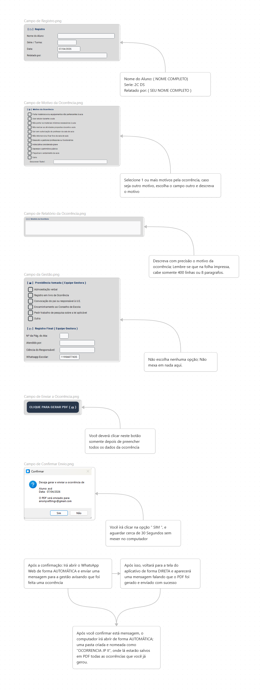

# Sistema de Ocorrências Escolar

Aplicativo desktop em Python para gerar, salvar e enviar fichas de ocorrência disciplinar da **E.E. João Paulo II — Mauá/SP**.

O sistema foi criado para transformar um processo manual da escola em um fluxo mais rápido: preencher os dados do aluno, selecionar o motivo da ocorrência, registrar o relato, gerar um PDF padronizado e enviar a ocorrência por e-mail, com notificação via WhatsApp.

> Projeto iniciado em **25/03/2026** e finalizado em **07/04/2026**.  
> Manutenções realizadas em **09/04/2026**, **10/04/2026** e **11/04/2026**.

---

## Funcionalidades

- Interface gráfica desktop com **CustomTkinter**.
- Formulário para identificação do aluno, série/turma, data e professor responsável.
- Lista de motivos de ocorrência com checkboxes.
- Campo de relato com contador de caracteres.
- Registro de providências tomadas pela equipe gestora.
- Geração automática de PDF em formato de ficha escolar.
- Salvamento dos PDFs na pasta `Documents/Ocorrencias_JPII`.
- Envio do PDF por e-mail usando Gmail API com OAuth 2.0.
- Notificação via WhatsApp usando PyWhatKit.
- Configuração segura por variáveis de ambiente usando `.env`.

---

## Download da versão executável

A versão pronta para uso está disponível na aba **Releases** do GitHub.

➡️ **Baixe a versão mais recente:**  
https://github.com/monaridev/sistemadeocorrencia/releases/latest

Essa opção é recomendada para quem quer apenas usar o sistema, sem precisar clonar o repositório ou executar o código Python manualmente.

---

## Documentação e apresentação

- [Documentação em PDF](docs/documentacao.pdf)
- [Apresentação em PowerPoint](docs/documentacao.pptx)

Esses materiais apresentam o problema, a solução proposta, a interface do sistema, o fluxo de funcionamento, as tecnologias utilizadas e o impacto real do projeto.

---

## Tutorial visual de uso

O repositório inclui um tutorial em imagem explicando o fluxo de uso do sistema, desde o preenchimento da ocorrência até o envio e geração do PDF.



---

## Tecnologias utilizadas

- **Python**
- **CustomTkinter** — interface gráfica moderna
- **Tkinter** — base da interface desktop
- **ReportLab** — geração de PDF
- **Pillow** — manipulação da imagem/logo no PDF e na interface
- **python-dotenv** — leitura de variáveis de ambiente
- **Gmail API / Google OAuth 2.0** — envio autenticado de e-mail
- **email** — montagem da mensagem MIME e do anexo
- **PyWhatKit** — envio de mensagem via WhatsApp Web

---

## Como executar pelo código-fonte

### 1. Clone o repositório

```bash
git clone https://github.com/monaridev/sistemadeocorrencia.git
cd sistemadeocorrencia
```

### 2. Crie um ambiente virtual

```bash
python -m venv .venv
```

Ative o ambiente:

```bash
# Windows
.venv\Scripts\activate
```

### 3. Instale as dependências

```bash
pip install -r requirements.txt
```

### 4. Configure as variáveis de ambiente

Crie um arquivo chamado `.env` na raiz do projeto, seguindo o modelo do arquivo `.env.example`:

```env
EMAIL_REMETENTE=seu_email@gmail.com
EMAIL_DESTINO=email_que_recebera_as_ocorrencias@gmail.com,outro_email@gmail.com
WHATSAPP_ESCOLAR=11999999999
```

O envio usa OAuth 2.0 e não exige credencial de e-mail no `.env`. Baixe no Google Cloud o arquivo OAuth de um cliente do tipo **Desktop App** e salve-o como `credentials.json` na mesma pasta de `ocorrenciaescolar.py`.

Na primeira tentativa de envio, o navegador abrirá para login e autorização. Após a autorização, o sistema criará `token.json` na mesma pasta. Nas execuções seguintes esse token será reutilizado e renovado automaticamente quando necessário.

Os arquivos `.env`, `credentials.json` e `token.json` são locais e não devem ser adicionados ao Git.

### 5. Execute o sistema

```bash
python ocorrenciaescolar.py
```

---

## Configuração do e-mail

O sistema usa a Gmail API oficial com OAuth 2.0 e somente a permissão `https://www.googleapis.com/auth/gmail.send`.

1. Ative a Gmail API no projeto do Google Cloud.
2. Configure a tela de consentimento OAuth e um cliente do tipo **Desktop App**.
3. Baixe o arquivo do cliente e salve-o localmente como `credentials.json`.
4. Configure `EMAIL_REMETENTE` e `EMAIL_DESTINO` no `.env`. Para vários destinatários, separe os endereços por vírgula.
5. Execute o sistema e conclua a primeira autorização no navegador.

O `token.json` criado após essa autorização deve permanecer gravável, pois poderá ser atualizado durante a renovação das credenciais.

---

## Pacote portátil para Windows

O build do Windows usa PyInstaller no modo `onedir`, que é mais confiável para incluir os arquivos de dados do CustomTkinter. A pasta portátil gerada é `dist/SistemaOcorrencias/` e deve ser copiada inteira.

Na raiz dessa pasta ficam:

```text
SistemaOcorrencias/
├── SistemaOcorrencias.exe
├── .env
├── credentials.json
├── token.json
└── _internal/
```

A pasta `_internal` contém as dependências empacotadas e é obrigatória. `.env`, `credentials.json` e `token.json` permanecem externos ao executável para permitir configuração e renovação do OAuth.

Para repetir o build em uma máquina Windows:

```bat
python -m pip install -r requirements-build.txt
build-windows.bat
```

---

## Configuração do WhatsApp

O envio via WhatsApp usa o **WhatsApp Web** por meio da biblioteca PyWhatKit.

Antes de enviar:

- deixe o Chrome instalado;
- entre no WhatsApp Web;
- mantenha a conta logada;
- evite mexer no navegador durante o envio automático.

---

## Arquivos principais

```txt
README.md
requirements.txt
requirements-build.txt
build-windows.bat
.env.example
.gitignore
ocorrenciaescolar.py
tutorial.png
docs/documentacao.pdf
docs/documentacao.pptx
```

O projeto atualmente está concentrado no arquivo `ocorrenciaescolar.py`, que contém a interface, a geração do PDF, o envio por e-mail e a notificação por WhatsApp.

---

## Status do projeto

Projeto funcional e finalizado para uso escolar, com melhorias posteriores de interface e correções no relato de ocorrência.

Possíveis melhorias futuras:

- separar o código em módulos;
- adicionar tela de configurações;
- melhorar o tutorial visual com título maior e revisão textual;
- adicionar print do PDF gerado;
- adicionar banco de dados local para histórico;
- criar testes para validação dos dados.

---

## Observação

Este projeto foi desenvolvido como solução prática para uma necessidade real da escola, com foco em automação, padronização de documentos e redução de trabalho manual.
